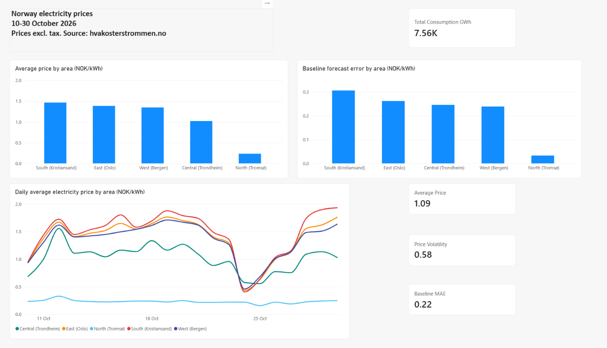

# Norway power market platform

An end-to-end data pipeline for hourly electricity prices, consumption and weather in Norway's five price areas (NO1 to NO5). GitHub Actions collects open data twice a day, Databricks models it in bronze, silver and gold layers, and Power BI reports on it.

## Results

- The daily run has collected data automatically since 6 October 2026, and ran 19 full days in a row without any manual help (14 October to 1 November).
- 385 raw files by 10 November: 185 price, 35 consumption and 165 weather files.
- 12 data-quality tests run on every push and in every daily run.
- `gold_hourly` in Databricks: 2,515 rows, one per price area and hour, from 10 to 30 October.
- Baseline forecast (yesterday's price for the same hour), mean absolute error from 10 to 30 October, in NOK per kWh: NO1 0.261, NO2 0.305, NO3 0.245, NO4 0.033, NO5 0.238.

## Architecture

1. **Ingestion:** three Python scripts fetch prices, consumption and weather forecasts. A scheduled GitHub Actions workflow runs them twice a day and commits the raw files to `data/raw/prices`, `data/raw/consumption` and `data/raw/weather`.
2. **Storage:** until 2 November 2026 the workflow also uploaded every file to Azure Data Lake Storage Gen2. The Azure setup is documented with screenshots in [docs/azure](docs/azure/README.md).
3. **Modelling in Databricks:** bronze tables keep the raw data unchanged, with the source file and load time added. Silver tables convert all times to UTC and remove duplicates. `gold_hourly` joins price, total consumption, the weather forecast and yesterday's price.
4. **Reporting:** a Power BI Desktop star schema (`fact_hourly`, `dim_area`, `dim_date`) with DAX measures for average price, price volatility, total consumption and baseline error.

## Design choices

**Security**
- The daily run signs in to Azure with OpenID Connect. Its federated credential trusts only the main branch of this repository, so no password or key is stored anywhere.
- Least privilege: the GitHub app can only write and the Databricks app can only read, and both roles are on the `raw` container only.
- The Databricks client secret lives in the Databricks secret store, not in the notebooks. The first SAS token was deleted and the storage key it was signed with was rotated.

**Reliability**
- Elhub publishes consumption late, so the script checks the last seven days and fetches every missing day.
- Weather requests retry after 10 and 20 seconds. After the third failure the run still fails, so a real problem still sends an email.
- The weather step runs even if an earlier step fails, because a forecast that is not saved today cannot be fetched later.
- Each test file also checks that it finds at least one file, so a wrong path turns the tests red instead of passing on an empty folder.

**Correctness**
- All times are converted to UTC in silver. Norway changed its clock on 25 October, so subtracting a fixed number of hours would have been wrong.
- `gold_hourly` uses the weather forecast made the day before, because that is what a real forecast for tomorrow could know. A newer forecast would leak future information.
- Power BI silently converted UTC to local time on import. I kept the time zone when reading the column, and checked the result by counting distinct hours.

## Limits

- Only three weeks of modelled data, so the baseline numbers will change.
- One weather point per price area.
- The Databricks layers are refreshed by hand, and the tables stop at 30 October because the Azure free credit ended.
- Prices are without VAT.

## Next

- [ ] Databricks bronze reads the raw files from this repository instead of Azure
- [ ] Security scans in GitHub Actions: Bandit and pip-audit
- [ ] A price forecast compared with the baseline
- [ ] Unusual price days explained with SHAP

## Repository

- `fetch_prices.py`, `fetch_consumption.py`, `fetch_weather.py`: daily ingestion scripts
- `.github/workflows/`: the daily run and the test run
- `tests/`: data-quality tests for each source
- `databricks/`: notebooks 01 to 08, from the Azure connection to the gold table. Azure IDs in the notebooks are placeholders.
- `docs/azure/`: Azure setup screenshots and notes
- `docs/powerbi/`: the Power BI report file and a screenshot
- `data/raw/`: raw files, unchanged
- `01` to `03_explore_*_api.ipynb`: first exploration of each API
- `upload_to_azure.py`: the upload step used until 2 November 2026

## Data sources

- Electricity prices: Strømpriser levert av [Hva koster strømmen.no](https://www.hvakosterstrommen.no). They get the prices from ENTSO-E. Prices are without VAT.
- Electricity consumption: [Elhub](https://api.elhub.no), open Energy Data API. Hourly consumption per price area and consumer group.
- Weather forecast: Based on data from [MET Norway](https://api.met.no), Locationforecast API, licensed under [CC BY 4.0](https://creativecommons.org/licenses/by/4.0/). One forecast point per price area.

## Tools

Python (requests, pytest), GitHub Actions, Git, Azure Data Lake Storage Gen2, Microsoft Entra ID (OIDC), Databricks (PySpark), Power BI Desktop (Power Query, DAX)

© 2026 Fahimeh Mottaghi. All rights reserved.
