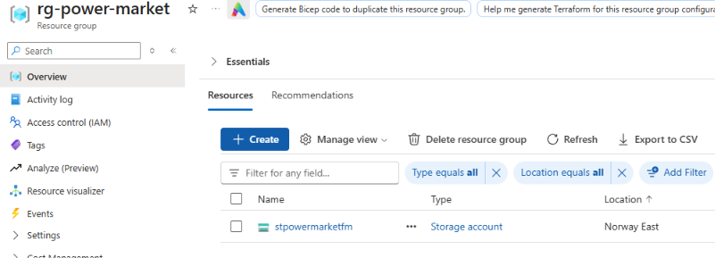
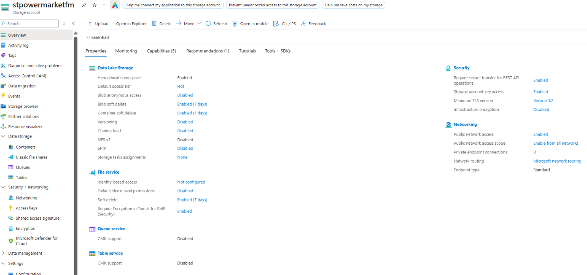
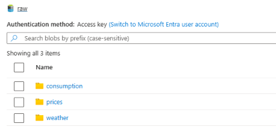
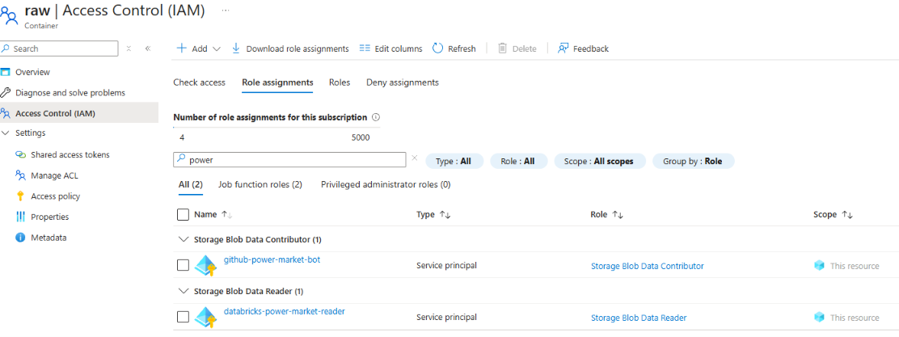
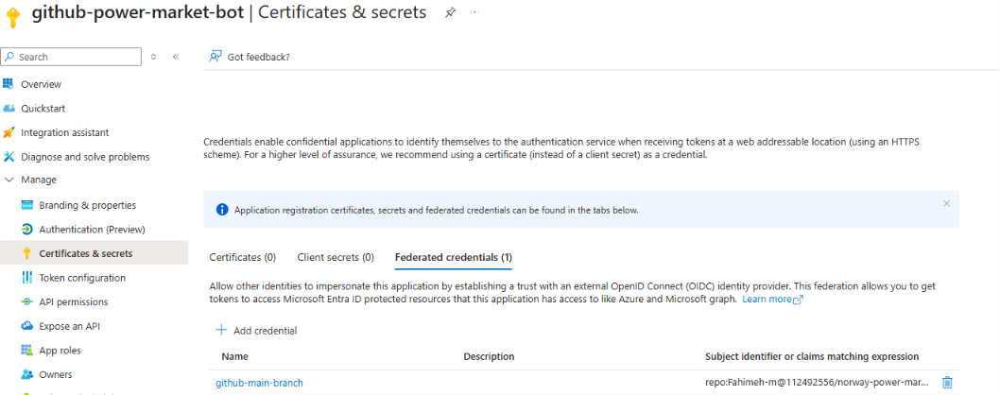
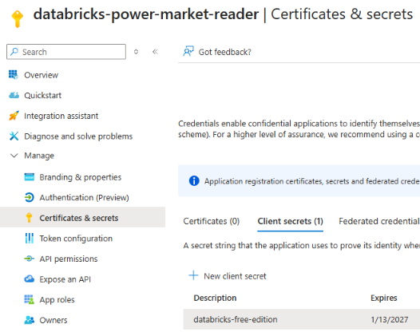
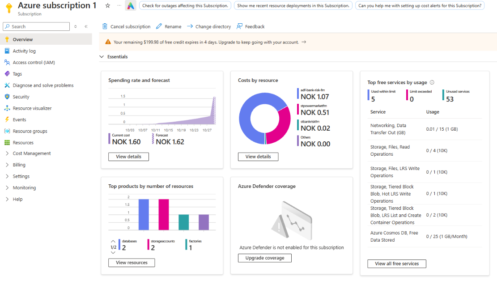

# Azure part of the project

This project ran on the Azure free account, and the free credit ends in early November 2026. Before it ended, I took screenshots of everything I built in Azure, so the setup stays visible after the resources are gone. The screenshots were taken on 31 October 2026.

## Resource group

Everything for this project lives in one resource group, `rg-power-market`, in Norway East. It holds a single resource: the storage account.

## Storage account

`stpowermarketfm` is a StorageV2 account with hierarchical namespace turned on, which makes it Azure Data Lake Storage Gen2. It uses the Hot tier and locally redundant storage (LRS). Anonymous access is off, and deleted blobs and containers can be restored for seven days.

One setting I would change: storage account key access is still enabled. Nothing in the project has used the keys since Day 7, when the daily run moved to OIDC and I rotated the key the old SAS token was signed with. Turning key access off would have been the cleaner choice.

## The raw container

The daily run uploads every raw file into the `raw` container, in three folders: `prices`, `consumption` and `weather`, with a subfolder for each day.

## Who can access the raw container

Two apps from Microsoft Entra ID have roles on the `raw` container only, not on the whole storage account:

- `github-power-market-bot`, used by the daily GitHub Actions run, has Storage Blob Data Contributor, because it writes files.
- `databricks-power-market-reader`, used by Databricks, has Storage Blob Data Reader, because it only reads them.

I filtered the list so that my own account is not in the screenshot.

## Sign-in for the daily run

The daily run signs in with OpenID Connect. The app has one federated credential, `github-main-branch`, which trusts only the main branch of this repository. The app has no client secrets at all.

## Sign-in for Databricks

Databricks Free Edition runs outside my Azure subscription, so it signs in with a client secret. The secret is kept in the Databricks secret store. The screenshot shows only its name and expiry date, 13 January 2027, not its value. Once the Azure credit ends, Databricks can no longer read from the storage account, so I will remove this secret from Databricks.

## Cost

By 31 October the whole subscription had cost NOK 1.60, shared between this project and another one. This project's storage account was NOK 0.51 of that.

I set a budget alert on Day 2, but when I checked on 31 October it was no longer in the portal, and I don't know when it was removed.

## After the free credit ends

My plan:

- Remove the Azure sign-in and upload steps from the daily run, so it keeps collecting prices, consumption and weather into this repository.
- Let the bronze notebooks in Databricks read the new files from this repository instead of from Azure. The tables already in Databricks stay as they are.
